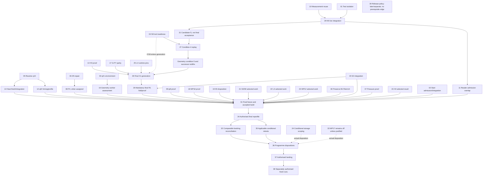

# Atlas optimisation plans: directory, dependencies and status

> Published copy (17 Oct 2026): Plans 01-25 and this index. Plans 26-39 are still under correction and are not
> included yet, so their links below do not resolve. Links to reviews, discussions and local records point to
> private working folders that are not published. Local user paths are replaced with `LOCAL_USER`.

**Status:** WORKING NON-CANON. Documentation corrected on 17 October 2026 under Michael's general901 assignment.  
**Scope:** 39 planning documents. Publication, implementation, proof, integration, scientific acceptance and canon are separate states.

**Plans10–12 update, 20 October:** implementation and selected private combined
integration are complete. The [additive source snapshot](../workbench/plans10-12/README.md)
retains earlier enabled changes with lf3 heat; H5a, D5 and P4 stay disabled.
Focused qualification passed 27 orchestration tests, three native-entry cases
and four heat cases. Retained q22 component, q46 ROOT-pair and q47 reuse-smoke
evidence belongs to the original profiles. The new profile needs its own eligible
ROOT; final assembly, the held full-interval chain, full-workflow cold recovery
and final combined timing remain later work. This supersedes older pending and
held wording for the completed bounded work, while preserving the historical
failures, observations and other run holds.

**Plan02 update, 20 October:** the selected caller/runner generation and loader
repair are installed privately and available as an additive public source
snapshot. Positive prepared publication/reopen and end review remain deferred.
Plan31 binding belongs to its separate later integration stage. See
[Plan02](plan-02-start-gate.md); this supersedes older Plan02 status below.

This index navigates the retained optimisation programme; it is not a production build, an acceptance certificate or a new assignment. The published N5 review snapshot is `b0590819a6e9dfb205453fc1b0af5cf4c1e1b433`; live runtime/final-composition integration remains outstanding. It is not the baseline of an already accepted combined build.

**Plan04 update, 20 October:** implementation ownership was transferred and the
available tool/caller/assembly integration is complete privately. Its source
export is authorised. This supersedes the older Plan04 pause, owner and interim
review restrictions below; scientific and unrelated job holds remain. See
[Plan04](plan-04-n9-width-tools.md) for exact remaining technical prerequisites.

**Plan05 update, 20 October:** implementation and integration are complete in
the selected private route and published as an additive source snapshot.
The corrected pair has complete physical correspondence and exact agreement;
the later scoped correctness disposition and executed q22 successor are recorded
in [Plan12](plan-12-heat-q22-abba.md). q10 FAIL, historical NOT REPRODUCED and the
original q22 hold remain preserved. [Plan05](plan-05-q10-heat-correctness.md)
supersedes its older ownership and unresolved-correspondence wording below.

## 1. Authority and holds

**Nothing is restarted by this document.** N9 scientific replay and fresh full intervals remain **HELD**. q10's historical H5a **FAIL** is preserved; the later scoped correctness disposition and executed q22 successor do not rewrite it or establish general causality. q21 is an invalid launch environment, not a worker-count or numerical result. The recorded individual holds include q01, q09, q18 and q20. A queued ticket grants no launch authority. The earlier global weekly hold was released, but that did not release individual holds, owner freezes or the fresh-run hold.

The present assignment authorises these documentation edits only. It authorises no Atlas implementation, runs, hold releases, source repins, landings, commits or pushes. Existing owners retain responsibility. No Git commit is claimed.

Current authority is in `C:/Users/LOCAL_USER/OneDrive/Documents/GitHub/atlas/.atlas-dev/`:

- `plan-status-20261016.md`: current order, status and acceptance boundaries.
- `optimisation-backlog-20261016.md`: scoped owner decisions.
- `run-queue-protocol-20261016.md`: queue, admission and resource rules, including amendments.
- `coordinator-handoff-20261016.md`: chronological decisions and superseding corrections.
- `improvements-table.md`: retained measurements and their actual scopes.
- `tectonics-completion-plan-20261016.md`: later tectonics scope and release work.

The per-plan primary owner records control detailed mechanisms. Reopen the relevant current records on an authorised implementation resume. A summary or old manifest row cannot override a later source decision.

## 2. Shared contracts

| Contract | Required meaning |
|---|---|
| Peak tree RSS | At most 12.0 GiB across the parent and all children; parent-only RSS is insufficient. |
| Free physical memory | At least 1.0 GiB during execution. |
| Logical memory | At most 16.0 GiB of runtime logical accounting; this is not process virtual-memory size. |
| Scope limits | Preserve the applicable 256 MiB scope caps and the actual owner's lifetime/accounting contract. |
| Start admission | Existing by-need rule: predicted peak × 1.2 + 2 GiB free headroom. Use qualifying matching-command observations and the prescribed booking fallback; never clip a prediction to force admission. |
| Record integer limit | 1 MiB = **8,388,608 bits**. This is distinct from D5's `2**27`-bit arithmetic ceiling. |
| Continuation width gate | `R/width_gate.py`: interval 1 uses `gate()`; N≥2 uses `gate_next()`. Projected W(N+1) must be ≤50% and W(N+2) ≤100% of the record limit. There is no 25% acceptance gate. The historical 2,054,539-bit residual is an observation, not a successor guarantee. |
| Numerical comparison | Exact field/number parity by default; only the explicitly approved identity translations and field-specific N9 exception apply. No blanket epsilon or tolerance widening. |
| Accepted steps | 256 is a ceiling, not a target, solver convergence condition or permission to accept a truncated interval. |
| Performance aim | Under five minutes wall time per interval remains an engineering goal. It is not measured combined performance or a physical contract. |

Full loaded-source identities, immutable stores, refusal semantics and historical receipts remain mandatory. A digest prefix is a readable reference, not an acceptable runtime identity check. Timing, profiling and shared-input work use the existing queue and actual owner gates; this index creates no tickets.

## 3. Complete plan directory

Ticket labels below refer to retained evidence or outstanding work, not permission to run. “Pending” does not imply tested or disabled. Each linked document gives the actual scope, primary sources and completion condition.

| Plan | Retained owner | Evidence / ticket | Actual work and current boundary |
|---|---|---|---|
| [01 — Runner test isolation](plan-01-runner-test-isolation.md) | Runner / Claude | Reviewed workbench successor; retained 235-test pass | Test-only repair and fixture checker published; frozen composition and live runtime unchanged. |
| [02 — By-need start gate](plan-02-start-gate.md) | Plan02 integration owner | Selected generation and loader repair installed privately; source snapshot published | Positive prepared publication/reopen and final review deferred; Plan31 integration is a later stage. |
| [03 — q21 launch environment](plan-03-q21-launch-environment.md) | Geometry / Runner; coordinator queue owner | r6 guard successor; r5 retained | Mandatory D08 preservation before launch and merge; focused checks recorded in Plan 03. The q21 retry requires separate authorisation. |
| [04 — N9 proof-tool repair](plan-04-n9-width-tools.md) | Plan04 implementation owner | r24/r5 tools installed privately; 71 retained + 6 focused cases passed | Actual Plan31 composition and authenticated producer/reader/Heat field binding open; both readiness guards false; collective review deferred. |
| [05 — q10 correctness](plan-05-q10-heat-correctness.md) | Transferred implementation owner | Integrated; corrected pair exact; acceptance pending | Complete physical correspondence, ownership repair and consumer integration published. Historical q10 FAIL / q32 NOT REPRODUCED and q22 HELD remain. |
| [06 — D5 exact arithmetic](plan-06-d5-exact-arithmetic.md) | Plan06 implementation owner; Pressure consumer | Repaired source snapshot; scoped private proof passed | D5 disabled for measured regressions; actual selected Plan31/N9 binding and collective review remain open. |
| [07 — Pressure P1–P3](plan-07-pressure-p1-p3-assessment.md) | Pressure; Geometry/Runner integrate | q02 pending | Small-case changes exist; obtain the authorised profile and full-scale proof before the owner integration handoff. |
| [08 — Pressure P4](plan-08-pressure-p4.md) | Pressure / Kernels | Not built | Design handover for the real P3 jet arithmetic and accepted shared mpq primitives; needs D5 readiness and an actual coordinator assignment. |
| [09 — Parallel admission ip9](plan-09-parallel-admission-ip9.md) | Kernels; Geometry review; Runner integration | q19 not launched | Prove the selected ip9 tree through the existing two-worker route and shared pressure/admission schema; no invented work-stealing architecture. |
| [10 — Initial measurement reuse](plan-10-measurement-reuse-n3.md) | Runner | Bounded implementation/private integration and q47 smoke complete | Producer-only smoke: 969 hits/zero misses, no reader, stop before advance. Independent reader recomputation remains required. New combined profile needs its own eligible ROOT. Earlier q08 scope and failures remain preserved. |
| [11 — Reader-admission overlap](plan-11-stage-overlap-phase2.md) | Runner | Implementation/private integration and q46 ROOT pair complete | Exact parity PASS; ROOT wall time 31.11% lower with sampled arm-tree RAM 74.23% higher in one original-profile pair. Actual interval/ALE evidence remains later; phases 1/3 stay deferred. |
| [12 — Heat timings/profile](plan-12-heat-q22-abba.md) | Heat; coordinator queue owner | q22 11/11 PASS; lf3 integrated privately | Component W4 supervised mean 109.625→80.742 s (26.347% lower). H5a is not selected. Combined focused checks PASS; final combined timing, full intervals and full-workflow cold recovery remain later. |
| [13 — H3 r3 proof](plan-13-heat-kernel-h3-q25.md) | Kernels / integration | Implemented and integrated locally; candidate-only | q25 and strict composed Heat proof passed; final 634-member source snapshot extends Plans10–12. Commit/push and later programme enablement are separate. |
| [14 — Heat finish markers](plan-14-heat-finish-closure-markers.md) | Runner / Heat / integration | Implemented and integrated locally | Heat S1 and loaded N5/N4 markers integrated; exact proof and focused controls passed. First-IV1 observations and conditional Heat S2/S4 remain later. |
| [15 — H4 worker sweep](plan-15-heat-worker-sweep-q01.md) | Runner; coordinator queue owner | q01 HELD | Resolve the actual harness, resource, seed, smoke/refuter and READY prerequisites before an authorised sweep. |
| [16 — Geometry worker assessment](plan-16-geometry-parallel-assessment.md) | Geometry / Runner; Storage handoff | q13 VOID-ENVIRONMENT; q21 invalid | Preserve distinct failed attempts; assess worker cap, rolling batches and clamp only after Plan 03 readiness and explicit retry disposition. |
| [17 — Geometry stacked parity](plan-17-geometry-arithmetic-q23-q24.md) | Geometry / Kernels | q23/q24 not launched | Real jets-r2 and D1/D2/G-PY r4 comparisons with required row repeats, sample/deep limits and gated promotion. |
| [18 — WP18 endpoint batching](plan-18-geometry-endpoint-batching-q18.md) | Geometry / Runner | q18 HELD | Reviewed endpoint clamp and cross-support lookahead at two workers; no SIMD packet scheme or abandoned hardest-first policy. |
| [19 — Whole-region remainder](plan-19-geometry-fast-paths.md) | Geometry; Small build helper | Owner scoping response pending | Identify a justified residual beyond RC1/certificates, or explain why no further build is justified. No residual implementation or ticket is invented. |
| [20 — S2 r9 captures](plan-20-diagnostic-captures-s2.md) | Small / Runner / Release | q15 timing pending | r9 selected for recorded exactness; preserve consumer/source integration and carry the fully pinned DLL through R1. r10 is reference only. |
| [21 — Small S3 and S9](plan-21-lazy-fields-s3-s9.md) | Small / Runner; coordinator | q20 HELD | Small S3 lazy D1-B rows is part-done; Heat S3's unscoped identity work is subsumed into S9. S10 remains withdrawn. |
| [22 — Storage L3](plan-22-storage-l3.md) | Storage / Runner | Accepted design, unbuilt | Carry verified page pins across read batches under the exact caps/freshness/lifetime contract. This is not a new LRU chunk cache. |
| [23 — WP12 sidecar reads](plan-23-storage-mapped-reads-wp12.md) | Storage | Conditional design, unbuilt | Positioned reads into fresh bytes with the same typed chunk authentication at use, guard-equivalence proof and net A/B gate. |
| [24 — Summaries and buffer pools](plan-24-storage-segment-summaries.md) | Storage | Conditional scoping | Use real q04 profile evidence. Summaries belong to the future format batch if justified; pools retain copy-out/lease/accounting obligations. |
| [25 — Runtime identity L4](plan-25-runtime-identity-l4.md) | Kernels; coordinator shared seam | Approved, not started | Patch the real runtime record with actual loaded arithmetic binaries/sources and trusted full pins, coordinated through C12/X1. |
| [26 — Helper fold R1](plan-26-packaging-helper-fold-r1.md) | Release / Small | Transformer/arm harness unbuilt | Mandatory last-N12 fold into `atlas_tectonics._private`, exact span edits, parity-v2, G-PIN and carried DLL; before fresh runs. |
| [27 — N9 condition-4 replay](plan-27-width-condition4-replay.md) | Pressure / Geometry / Runner; Codex tools paused | No replay run; PAUSED | Both sequential arms use candidate composed-f1 with approved source differences and policy v2; successful replay precedes condition-5 integration. |
| [28 — Shared identity X1](plan-28-shared-identity-x1.md) | Coordinator / existing component owners | Generation pending | Coordinate H3/G-PY/N9/L4 and mandatory final R1; preserve the L4 fallback and bottom-up pins, without a replacement identity registry. |
| [29 — N5 live integration](plan-29-runner-integration-n5.md) | Runner / Claude | chain-r3 published at b059081 | Live composition swap/profile pin remains. Preserve one selected profile per lineage and the I1→I2 profile-change refusal. |
| [30 — B17 and item14](plan-30-reopen-speed-b17.md) | Storage / Runner | q04 PASS; merged Storage sources | Preserve the tested merged implementation in final composition. 46.13→15.67 s is scoped combined heat-store reopen evidence. |
| [31 — N12 final assembly](plan-31-final-assembly-n12.md) | Small / coordinator | Draft manifest, build pending | Separate candidate f1, N9 replay/condition 5 and final freeze/fold. C18 rebase and f2→I19 no-write confirmation remain pending. |
| [32 — N10 booking reconciliation](plan-32-memory-accounting-n10.md) | Existing owners / coordinator | Comparable measurements only | Reconcile actual versus booked peaks after relevant authorised measurements; use existing admission controls and unchanged in-run guards. |
| [33 — WP17 query store](plan-33-query-storage-wp17.md) | Storage / Runner | Durability PASS (12 kills); off | Judge the measured reopen/write/hit trade-off against representative counts. No new SQLite store or invented enablement threshold. |
| [34 — Remaining hotspots](plan-34-remaining-hotspots-reprofile.md) | Kernels / Release | Final reprofile not done | Reprofile after Python changes; retain both compiler and group gates with their distinct denominators, plus K4's capacity/packaging route. |
| [35 — Combined-build retests](plan-35-combined-performance-retests.md) | Final coordinator / owners | AM §5 conditional list | Existing harnesses at IV2 scale where justified, absolute seconds and exact status. Structural zeros and safety exclusions remain separate. |
| [36 — Evidence/dispositions](plan-36-final-acceptance-record.md) | N12 Small/coordinator; final runner/coordinator | Records pending | Separate build acceptance from programme dispositions; authentic backlog identities, source-bound proof and honest unresolved/not-built states. |
| [37 — Landing on remake](plan-37-landing-remake.md) | Release / coordinator | Landing pending | Actual U0–U6 import tranches, EXPECTATIONS A–D, source-bound chapters, full DLL pin and final successor captures; explicit publication authority required. |
| [38 — Fresh full intervals](plan-38-whole-interval-validation.md) | Final Runner / coordinator | HELD | Real chain-r3, solver/lineage/source/width/resource contracts and genuine sealed outputs, only after separate launch authorisation. |
| [39 — Release policy](plan-39-release-vs-debug.md) | Release / coordinator | Later/separate | Implement RC §5 decisions 1–6, B13 and R1–R6 at I11.5/I12.2; retain functional instrumentation and refuse `-O`. |

## 4. Dependencies and staging

Edges below describe selected execution dependencies, not permission or a demand to run every optional candidate. An item's source contract can require additional owner-specific gates. Unmeasured conditional candidates may remain unresolved; a recorded exclusion must retain its actual reason and scope.

The main completion order is **final Plan 31 assembly → Plan 34 reprofile → Plan 35 applicable retests → Plan 36 dispositions → Plan 37 landing → separately authorised Plan 38 fresh runs**. Plan 32 follows the relevant measurements, not a speculative foundation calibration. Plan 39 is later/separate and gates none of Plans 31/35/37/38.

Plan 31 has two distinct states: a source-bound candidate needed for replay, and the final accepted freeze/fold. A candidate is not accepted by naming it composed-f1. The owner-approved replay candidate may contain the required test-only route before final component integration; arrows into the final freeze do not make that freeze a prerequisite of the replay. R1 development/smoke uses the approved read-only composed-r2 input; its ticketed parity uses composed-f1 when ready. X1 coordination spans the process; its final selected generation must satisfy the N9 and mandatory-fold contracts.

The graph's “selected work/result” nodes mean a justified, source-bound disposition and integration of anything enabled. They do not require every unbuilt or conditionally deferred candidate to be enabled. In particular, WP17 can remain off; later fresh-run counts can motivate a separately authorised reassessment without making those future counts a prerequisite for the first held run.

**Evidence coverage is broader than dependency edges:** every Plan 01–39 reports its actual outcome, blocker or residual status into the existing Plan 36 record under its authentic backlog/PS identity. Plans 37–39 contribute later lifecycle status, not future “accepted” prerequisites of the pre-landing record. Process items, assembly and the record itself are not additional enabled optimisations. This evidence mapping is not a cyclic execution dependency.

## 5. Decisions that must survive composition

- **RAM for speed:** higher RAM use is acceptable for measured speed improvements within the existing memory/admission limits. Keep numerical accuracy and run/enablement holds.

- **C18:** the final 19:18 amendment reopens the S1/start-gate rebase. Preserve the actual successor seam/proof requirement until closed; the earlier no-rebase statement is superseded.
- **ip9:** C1's ip9-on-f2 choice is resolved. Geometry's intervening-stage DG/dual no-write confirmation remains pending, alongside q19 proof.
- **H5a:** the earlier refuter record exists. It does not erase the later q10 FAIL or release q22.
- **N9:** C7's file selection is resolved as E (`_representative_pose`). Replay, condition-5 integration, successor width repin and explicit resume remain outstanding.
- **Two S3 scopes:** Small S3 means lazy D1-B rows; Heat S3's unscoped metric-identity work is subsumed into Small S9. Neither is an AM §5 exclusion.
- **X1/R1:** mandatory last-stage fold before fresh runs, with the approved L4 timing fallback. Old package-after-runs wording cannot reverse the current accepted order.
- **Compiler/groups:** after Step19, K1+K2 must retain about 15% of interface CPU for the conditional compiler decision; the speed-driven per-group gate is about 10% of interval CPU plus about 5% projected interval saving. Keep K4's separate memory/packaging route.
- **13A and conditional retests:** retain “not built” where that is the source disposition. Profile-based scoping is not proof of an implemented cache. Do not reopen WP11/BVH structural cases or packed-key/H5b/S10 safety exclusions as ordinary marginal-gain candidates.

## 6. Review and delivery status

[Codex's initial review set](reviews/codex/README.md), [consolidated response](../discussions/atlas-plans-39-review-20261017/codex-consolidated-response-23-39.md), [Claude's accepted addendum](reviews/claude/consolidated-23-39-addendum-r1.md) and [closure record](../discussions/atlas-plans-39-review-20261017/codex-consolidated-closure-23-39.md) preserve the attributed decisions and limitations. General891/894 established three-agent agreement on the Plans 23–39/INDEX correction lists; general901 authorised applying them. Applying the corrections is documentation completion, not independent acceptance of implementation.

Plans 01–22 match Codex's recorded post-edit hashes at the recovered checkpoint. That establishes unchanged saved edits, not an invented blanket final vote or Git commit. Preserve any actual recorded acceptance and recover only specifically missing decisions.

Measured improvements require comparable before/after evidence, source/configuration identity and real time/RAM/disk scope. Do not sum overlapping gains, promote sampled proof to complete proof, or turn a missing measurement into zero. Do not force unresolved, held or unbuilt work into a binary enabled/disabled status. Generated scientific output becomes Diadem canon only through the separate authority process.

